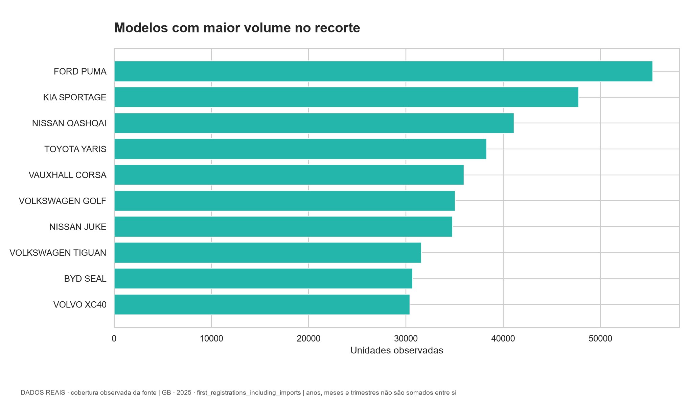
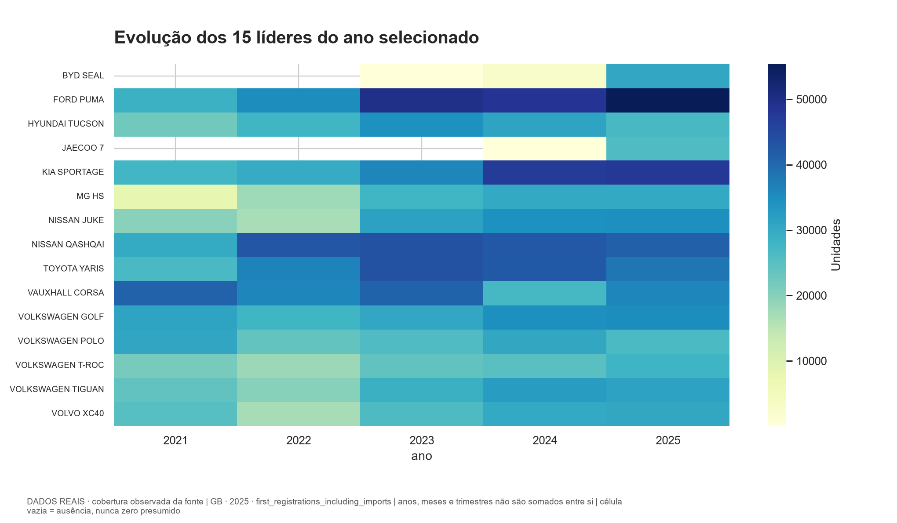
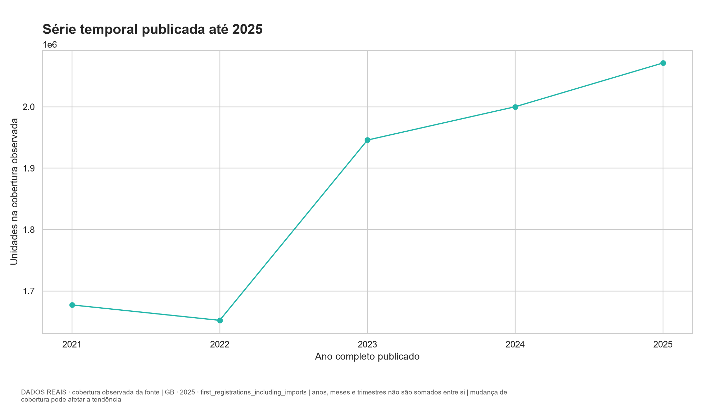
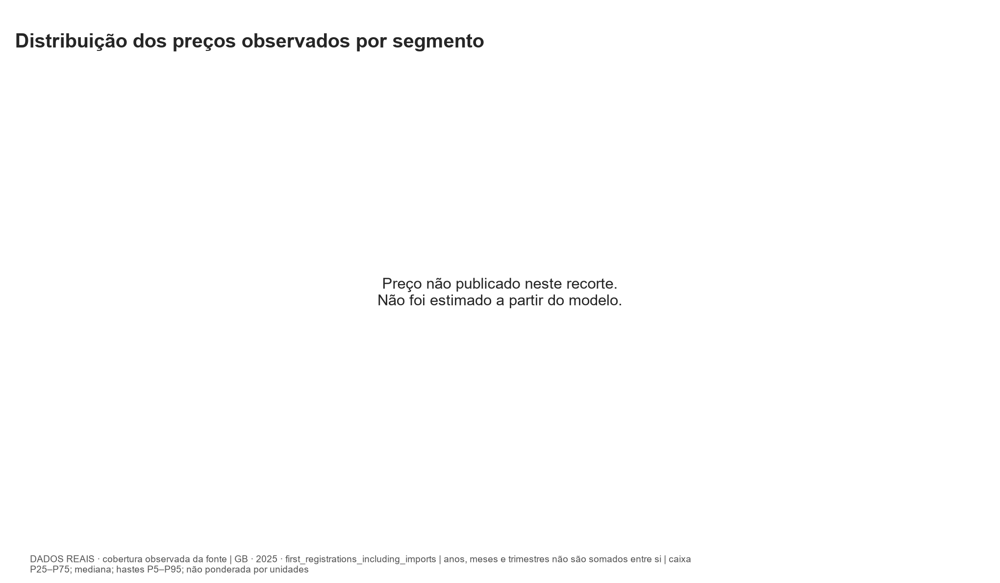
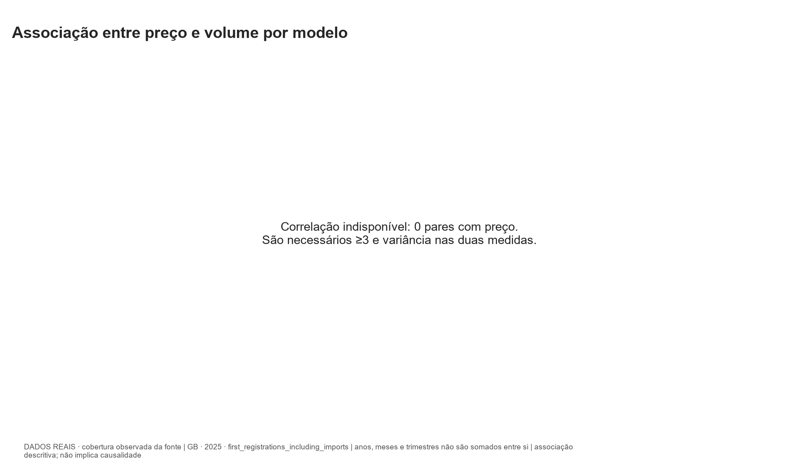
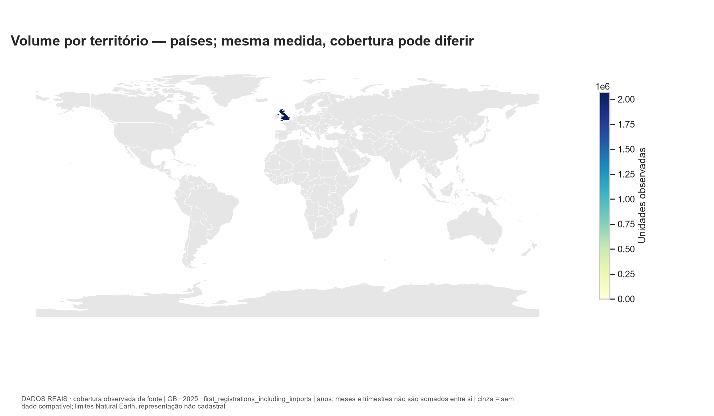
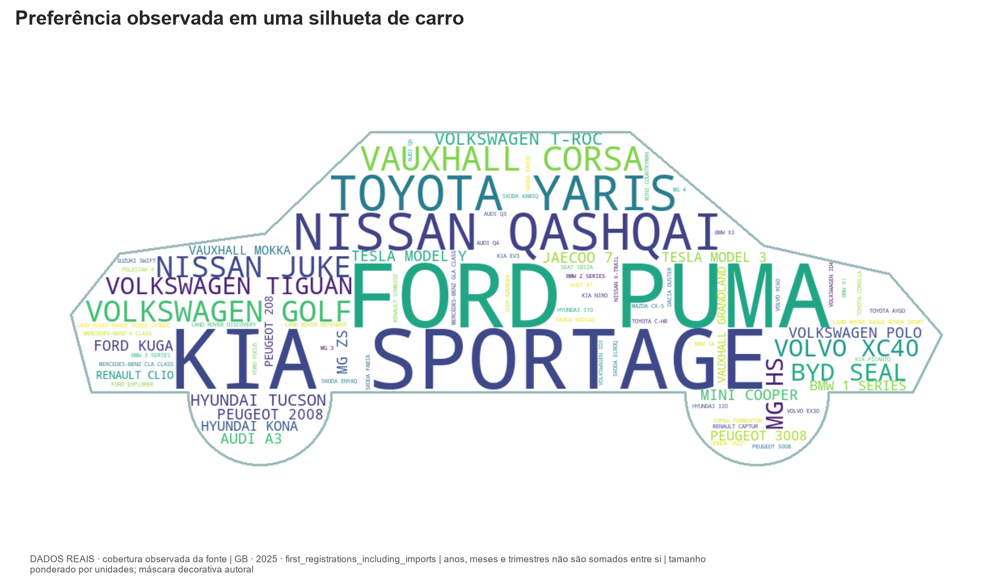

# Análise — GB, 2025

**DADOS REAIS · cobertura observada da fonte**

Medida: `first_registrations_including_imports`. Apenas registros anuais neste ranking.

Volume observado: **2,071,394** unidades; **1146** modelos.
Líder: **FORD PUMA**, 55,376 unidades.
Denominador compatível: 2071394.
Correlação preço/volume: indisponível; 0 pares.

## Estatísticas dos volumes por modelo

Média: 1,807.50; mediana: 11.00; desvio padrão amostral: 5,278.72; mínimo: 1; máximo: 55,376. Estas estatísticas descrevem os modelos presentes no recorte; não representam todos os modelos quando a fonte é top N.

## Interpretação e limites

A origem e a medida permanecem fixas em cada consulta. Totais anuais não são somados a meses ou trimestres. Ausência em ranking parcial não significa zero. A série acompanha a cobertura carregada, que pode mudar com a publicação. Primeiro registro DfT inclui importados usados; não é venda de novos. Correlação não estabelece causalidade. Mapas usam volume absoluto e não controlam população ou tamanho do mercado.

## Projeção exploratória

{
  "disponivel": false
}

A tendência linear serve apenas como demonstração; poucos anos, mudanças de cobertura e ausência de variáveis externas limitam qualquer uso preditivo. O backtest avança no tempo, sem treinar no futuro. Não há intervalo probabilístico.

## Gráficos

## Proveniência

Consulta UTC: 2026-10-29T16:51:04.476472+00:00. Execução ETL: `342c07b3-d980-464d-bdb6-d0b137919a1b`.

- [UK Department for Transport / Driver and Vehicle Licensing Agency: df_VEH0160_UK — Vehicles registered for the first time by body type, make, generic model, model and fuel](https://assets.publishing.service.gov.uk/media/6aad4b1ef1f8d2a39605fa1b/df_VEH0160_UK.csv) · `UK_DFT_VEH0160` · Open Government Licence v3.0. BodyType Cars only; all generic models and fuels; separate full annual aggregates and published quarters. First UK registrations include imported vehicles, including previously used imports. Not equivalent to SMMT new-car sales. Administrative make/model errors and missing generic-model categories are preserved. Quarterly data must never be interpolated to months. Prices and SUV/sedan/hatch segments absent.