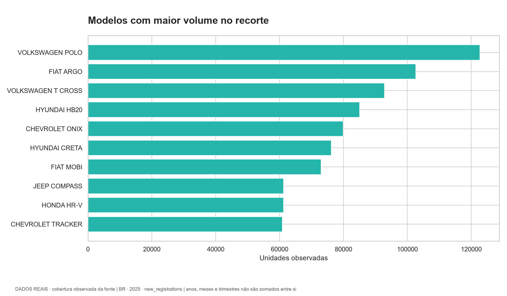
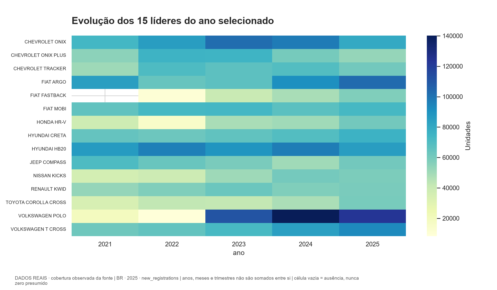
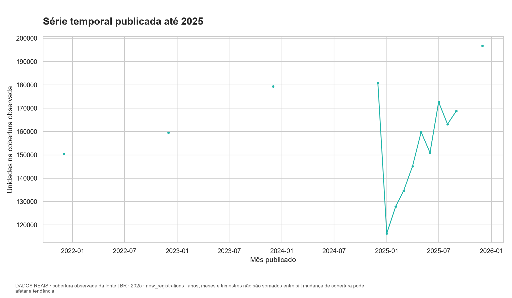
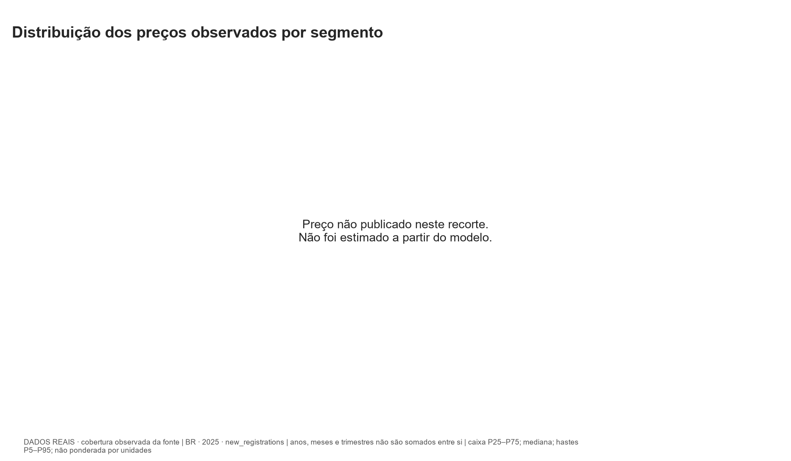
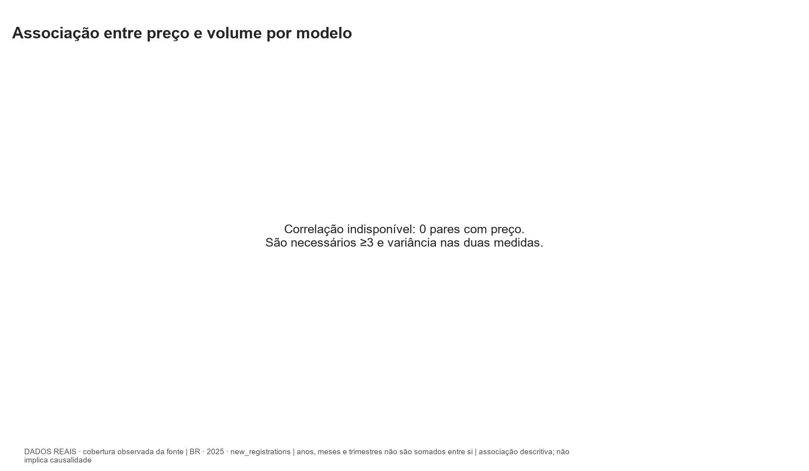
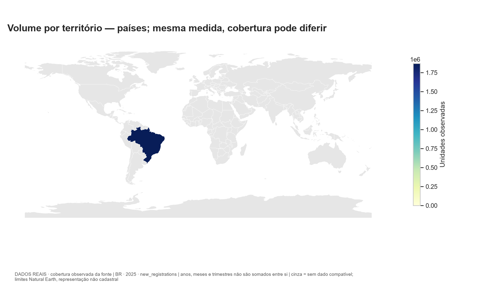
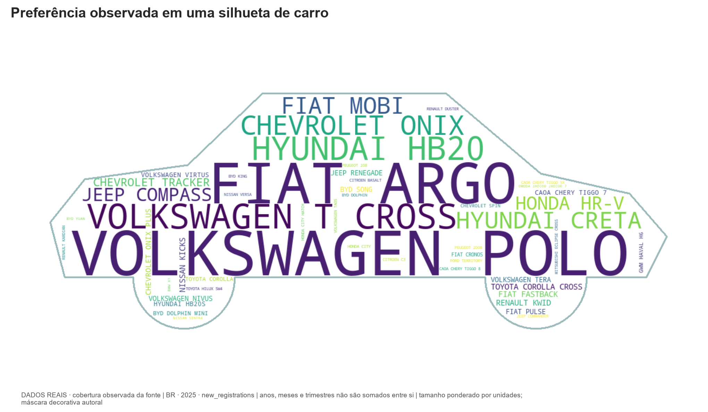

# Análise — BR, 2025

**DADOS REAIS · cobertura observada da fonte**

Medida: `new_registrations`. Apenas registros anuais neste ranking.

Volume observado: **1,872,220** unidades; **50** modelos.
Líder: **VOLKSWAGEN POLO**, 122,672 unidades.
Denominador compatível: 1996531.
Correlação preço/volume: indisponível; 0 pares.

## Estatísticas dos volumes por modelo

Média: 37,444.40; mediana: 32,211.50; desvio padrão amostral: 28,482.21; mínimo: 4,919; máximo: 122,672. Estas estatísticas descrevem os modelos presentes no recorte; não representam todos os modelos quando a fonte é top N.

## Interpretação e limites

A origem e a medida permanecem fixas em cada consulta. Totais anuais não são somados a meses ou trimestres. Ausência em ranking parcial não significa zero. A série acompanha a cobertura carregada, que pode mudar com a publicação. Primeiro registro DfT inclui importados usados; não é venda de novos. Correlação não estabelece causalidade. Mapas usam volume absoluto e não controlam população ou tamanho do mercado.

## Projeção exploratória

{
  "disponivel": false
}

A tendência linear serve apenas como demonstração; poucos anos, mudanças de cobertura e ausência de variáveis externas limitam qualquer uso preditivo. O backtest avança no tempo, sem treinar no futuro. Não há intervalo probabilístico.

## Gráficos

## Proveniência

Consulta UTC: 2026-10-29T16:51:00.783208+00:00. Execução ETL: `342c07b3-d980-464d-bdb6-d0b137919a1b`.

- [Fenabrave: Emplacamentos 05/2025](https://www.fenabrave.org.br/portal/files/2025_05_02.pdf) · `FEN_2025_05` · Direitos da publicação Fenabrave preservados; licença aberta não identificada. Extrato factual para pesquisa pessoal.. Top 50 de automóveis novos nacionais; total elegível da mesma edição. Sem versão, combustível, preço, categoria de carroceria ou geografia estadual. Snapshots e revisões por edição. Série mensal histórica parcial.
- [Fenabrave: Emplacamentos 02/2025](https://www.fenabrave.org.br/portal/files/2025_02_02.pdf) · `FEN_2025_02` · Direitos da publicação Fenabrave preservados; licença aberta não identificada. Extrato factual para pesquisa pessoal.. Top 50 de automóveis novos nacionais; total elegível da mesma edição. Sem versão, combustível, preço, categoria de carroceria ou geografia estadual. Snapshots e revisões por edição. Série mensal histórica parcial.
- [Fenabrave: Emplacamentos 12/2022](https://www.fenabrave.org.br/portal/files/2022_12_2.pdf) · `FEN_2022_12` · Direitos da publicação Fenabrave preservados; licença aberta não identificada. Extrato factual para pesquisa pessoal.. Top 50 de automóveis novos nacionais; total elegível da mesma edição. Sem versão, combustível, preço, categoria de carroceria ou geografia estadual. Snapshots e revisões por edição. Série mensal histórica parcial.
- [Fenabrave: Emplacamentos 08/2025](https://www.fenabrave.org.br/portal/files/2025_08_02.pdf) · `FEN_2025_08` · Direitos da publicação Fenabrave preservados; licença aberta não identificada. Extrato factual para pesquisa pessoal.. Top 50 de automóveis novos nacionais; total elegível da mesma edição. Sem versão, combustível, preço, categoria de carroceria ou geografia estadual. Snapshots e revisões por edição. Série mensal histórica parcial.
- [Fenabrave: Emplacamentos 04/2025](https://www.fenabrave.org.br/portal/files/2025_04_02.pdf) · `FEN_2025_04` · Direitos da publicação Fenabrave preservados; licença aberta não identificada. Extrato factual para pesquisa pessoal.. Top 50 de automóveis novos nacionais; total elegível da mesma edição. Sem versão, combustível, preço, categoria de carroceria ou geografia estadual. Snapshots e revisões por edição. Série mensal histórica parcial.
- [Fenabrave: Emplacamentos 12/2025](https://www.fenabrave.org.br/portal/files/2025_12_02.pdf) · `FEN_2025_12` · Direitos da publicação Fenabrave preservados; licença aberta não identificada. Extrato factual para pesquisa pessoal.. Top 50 de automóveis novos nacionais; total elegível da mesma edição. Sem versão, combustível, preço, categoria de carroceria ou geografia estadual. Snapshots e revisões por edição. Série mensal histórica parcial.
- [Fenabrave: Emplacamentos 12/2024](https://www.fenabrave.org.br/portal/files/2024_12_02.pdf) · `FEN_2024_12` · Direitos da publicação Fenabrave preservados; licença aberta não identificada. Extrato factual para pesquisa pessoal.. Top 50 de automóveis novos nacionais; total elegível da mesma edição. Sem versão, combustível, preço, categoria de carroceria ou geografia estadual. Snapshots e revisões por edição. Série mensal histórica parcial.
- [Fenabrave: Emplacamentos 12/2021](https://www.fenabrave.org.br/portal/files/2021_12_2.pdf) · `FEN_2021_12` · Direitos da publicação Fenabrave preservados; licença aberta não identificada. Extrato factual para pesquisa pessoal.. Top 50 de automóveis novos nacionais; total elegível da mesma edição. Sem versão, combustível, preço, categoria de carroceria ou geografia estadual. Snapshots e revisões por edição. Série mensal histórica parcial.
- [Fenabrave: Emplacamentos 12/2023](https://www.fenabrave.org.br/portal/files/2023_12_2.pdf) · `FEN_2023_12` · Direitos da publicação Fenabrave preservados; licença aberta não identificada. Extrato factual para pesquisa pessoal.. Top 50 de automóveis novos nacionais; total elegível da mesma edição. Sem versão, combustível, preço, categoria de carroceria ou geografia estadual. Snapshots e revisões por edição. Série mensal histórica parcial.
- [Fenabrave: Emplacamentos 03/2025](https://www.fenabrave.org.br/portal/files/2025_03_02.pdf) · `FEN_2025_03` · Direitos da publicação Fenabrave preservados; licença aberta não identificada. Extrato factual para pesquisa pessoal.. Top 50 de automóveis novos nacionais; total elegível da mesma edição. Sem versão, combustível, preço, categoria de carroceria ou geografia estadual. Snapshots e revisões por edição. Série mensal histórica parcial.
- [Fenabrave: Emplacamentos 01/2025](https://www.fenabrave.org.br/portal/files/2025_01_02.pdf) · `FEN_2025_01` · Direitos da publicação Fenabrave preservados; licença aberta não identificada. Extrato factual para pesquisa pessoal.. Top 50 de automóveis novos nacionais; total elegível da mesma edição. Sem versão, combustível, preço, categoria de carroceria ou geografia estadual. Snapshots e revisões por edição. Série mensal histórica parcial.
- [Fenabrave: Emplacamentos 07/2025](https://www.fenabrave.org.br/portal/files/2025_07_02.pdf) · `FEN_2025_07` · Direitos da publicação Fenabrave preservados; licença aberta não identificada. Extrato factual para pesquisa pessoal.. Top 50 de automóveis novos nacionais; total elegível da mesma edição. Sem versão, combustível, preço, categoria de carroceria ou geografia estadual. Snapshots e revisões por edição. Série mensal histórica parcial.
- [Fenabrave: Emplacamentos 06/2025](https://www.fenabrave.org.br/portal/files/2025_06_02.pdf) · `FEN_2025_06` · Direitos da publicação Fenabrave preservados; licença aberta não identificada. Extrato factual para pesquisa pessoal.. Top 50 de automóveis novos nacionais; total elegível da mesma edição. Sem versão, combustível, preço, categoria de carroceria ou geografia estadual. Snapshots e revisões por edição. Série mensal histórica parcial.
- [Fenabrave: Emplacamentos 09/2025](https://www.fenabrave.org.br/portal/files/2025_09_02.pdf) · `FEN_2025_09` · Direitos da publicação Fenabrave preservados; licença aberta não identificada. Extrato factual para pesquisa pessoal.. Top 50 de automóveis novos nacionais; total elegível da mesma edição. Sem versão, combustível, preço, categoria de carroceria ou geografia estadual. Snapshots e revisões por edição. Série mensal histórica parcial.